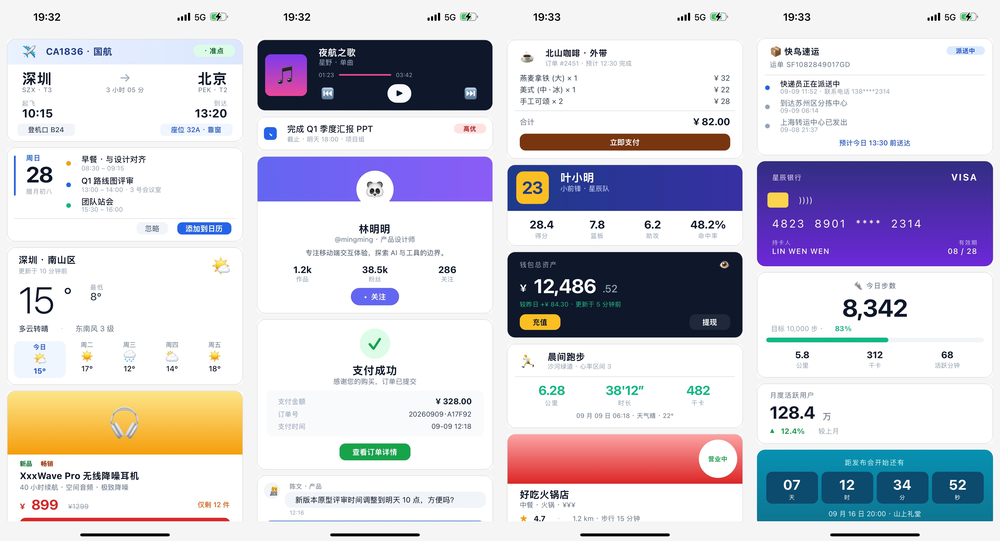
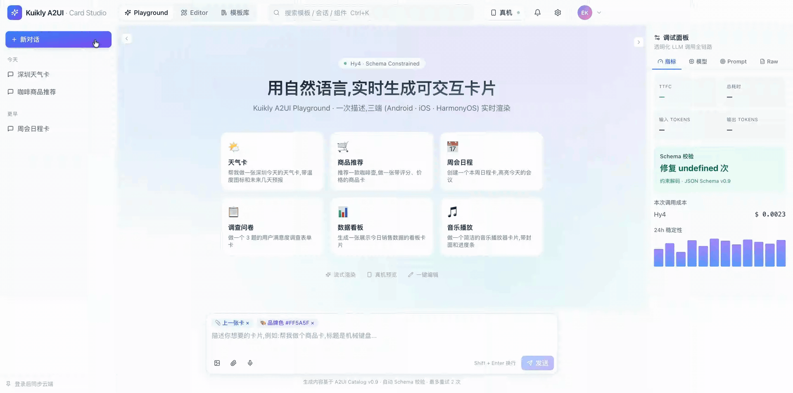
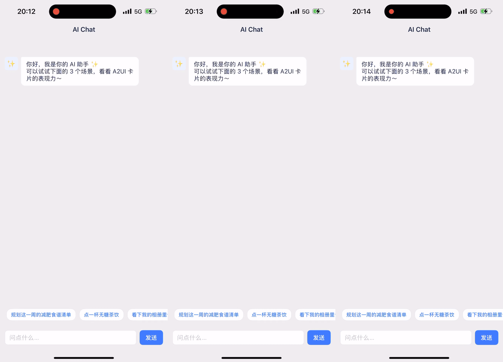
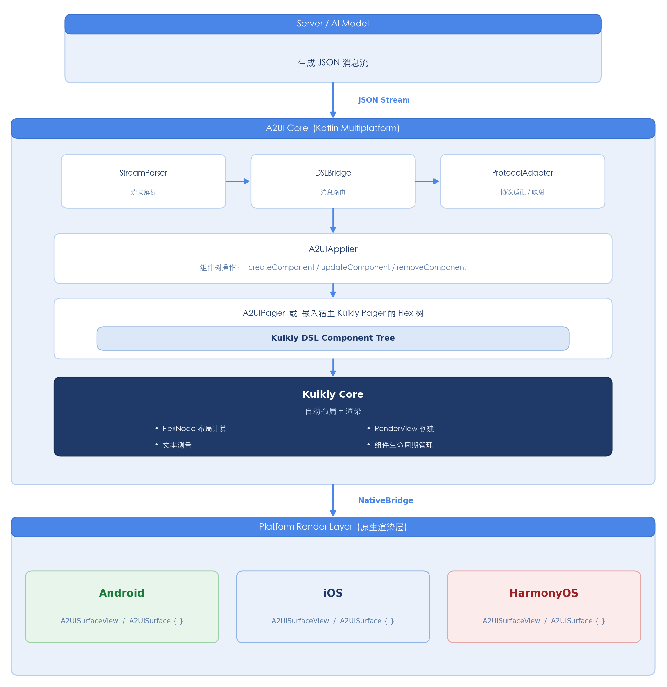

# Kuikly A2UI：由 AI 驱动的原生跨端 UI 渲染引擎

> 导语：[Kuikly](https://github.com/Tencent-TDS/KuiklyUI) 是由 PCG 端框架团队、QQ 团队、腾讯视频团队合作共建的 Kotlin Multiplatform 跨端 UI 框架，也是 [腾讯端服务联盟](https://framework.tds.qq.com/)（TDS）的重要成员。[Kuikly A2UI](https://github.com/Tencent-TDS/KuiklyUI-A2UI) 是腾讯 Kuikly 团队推出的 "AI-to-UI" 渲染引擎——对齐 A2UI 开源协议，让服务端大模型只需下发一段 JSON 消息流，客户端便能在 Android、iOS、HarmonyOS 上实时渲染出 100% 原生性能的 UI 界面。

---

## 一、简介

随着大模型在各类应用对话场景中的广泛落地，回复内容正由静态文本向可视化、可交互的 UI 界面演进。[A2UI 协议](https://a2ui.org/) 由此而生：服务端大模型生成一段结构化 JSON，动态描述 UI 卡片的组成与行为；客户端依据 JSON 所描述的 UI 树实时渲染出界面，从而将「文字回答」升级为「可点、可填、可用」的交互体验。

**Kuikly A2UI 以 Kuikly 经过业务规模验证的跨端渲染能力为底座，完整实现了 A2UI 协议在 Android、iOS、HarmonyOS 三端的原生渲染体验，并在表现效果、自定义组件、接入方式等方面做了必要的能力扩展。**

Kuikly A2UI 覆盖了 A2UI 协议定义的 18 个标准组件（Text / Image / Button / Card / Column / Row / List / Tabs / Slider / CheckBox / ChoicePicker / DateTimeInput / TextField / Video / AudioPlayer / Modal / Divider / Icon），并支持业务自定义组件，Agent 可据此灵活组合，生成行程、天气、商品、表单、事项等多种形态的卡片。下面是 Kuikly A2UI 的部分渲染效果：

<div style="display: inline-block; text-align: center; margin-left: 20px;">
  
</div>

在标准协议之外，面向实际业务更广泛的组件需求与视觉诉求，Kuikly A2UI 还提供：

* 对表格、图表、动画等更丰富组件形态的支持；
* 贴合 App 整体视觉风格的主题化能力；
* 卡片内容的渐进式展示能力。

同时，配套工具 Kuikly A2UI Card Studio 与 Kuikly A2UI Playground 正在建设中，用于支撑卡片生产、调试与效果预览：

<div style="display: inline-block; text-align: center; margin-left: 20px;">
  
</div>

## 二、使用场景

Kuikly A2UI 的定位是：让 AI 大模型以 UI 卡片的形式与用户交互。因此，凡是对话场景中由模型实时生成内容、并希望以更直观形态呈现给用户的场合，都适合接入。典型场景包括：

- **信息展示类**：例如展示航班状态、天气详情、新闻摘要等，由模型生成卡片 JSON，客户端直接渲染为图文并茂的卡片；
- **表单与交互类**：例如让用户填写一份带字段校验的表单，用户提交后产生 Action 回传至模型，形成对话闭环；
- **交易与跳转类**：例如在对话中插入一张可点击的商品卡片，点击「购买」按钮触发 Action，可本地跳转至商品页，也可直接完成支付。

从适用范围看，Kuikly A2UI 探索了多种场景的支持：

- **实时生成卡片场景**：适用于内容泛展示类场景（如搜索结果、资讯汇总），模型按需生成、即时渲染，追求表现力与多样性；
- **预置卡片场景**：适用于严谨性要求高的垂直场景（如支付确认、金融行情、外卖下单），由业务方定义卡片模板，运行时由 AI 或运营系统下发数据进行填充，追求稳定性与一致性；
- **AI 操作 UI 场景**：这种场景可能无卡片，或一个简单过度卡片。

三种场景示例分别如下：

<div style="display: inline-block; text-align: center; margin-left: 20px;">
  
</div>

## 三、特点与优势

在对齐 A2UI 协议基础能力（UI 表达丰富、支持交互、无需发版更新）的同时，Kuikly A2UI 在以下维度形成了自身的差异化优势：

- **原生性能**：基于 Kuikly 的原生渲染管线，保留原生 UI 的流畅度与交互一致性，内存占用较同类方案更优；
- **视觉表现增强**：Kuikly A2UI 所使用的协议在 A2UI 之上做了 **UI 表现能力增强**——在保持标准协议向后兼容的前提下，为每个组件补充了可选的 `styles` 属性包，使服务端能够更精细地描述组件的原生视觉效果，包括渐变、阴影、圆角、变换、文本装饰等；
- **扩展能力**：支持业务自定义组件、自定义函数、自定义 Icon 图集，便于沉淀业务组件库；
- **接入灵活**：既支持在 App 原生页面中直接嵌入 AI 生成的卡片，也支持在既有 Kuikly 页面中无缝集成，接入成本低；
- **三端一致**：同一份协议内容在 Android、iOS、HarmonyOS 上保持一致的渲染表现与交互行为。

相较于业内多数方案集中于 Web 技术栈，Kuikly A2UI 以移动端原生为主阵地，面向真实 App 场景提供端到端能力，这也是其在当前生态中的核心差异化定位。

## 四、原理与架构

Kuikly A2UI 核心 SDK 的职责有二：一是将服务端下发的 JSON 流渲染为 UI 卡片；二是将用户在卡片上的操作以 Action 回调的形式交回业务层。

接入后，服务端 AI 智能体、业务客户端与 Kuikly A2UI SDK 构成一条完整链路：服务端生成 JSON 流下发至业务客户端，由 SDK 完成渲染；用户操作卡片产生 Action，业务客户端根据 Action 类型判断是本地处理，还是回传给服务端；服务端收到 Action 后，可进一步生成新的 JSON 流，驱动 UI 的下一轮更新。整体链路如下：

<div style="display: inline-block; text-align: center; margin-left: 20px;">
  
</div>

在 SDK 内部，JSON 协议并未走额外的中间渲染层，而是直接对接 Kuikly 的 DSL 组件树，经由 Kuikly Core 调度生成原生视图树，实现真正意义上的「服务端驱动 UI」。内部数据流转可概括为：协议 → 内部消息 → DSL 操作 → 原生视图。架构示意如下：

<div style="display: inline-block; text-align: center; margin-left: 20px;">
  
</div>

值得一提的是，A2UI 协议采用邻接表结构描述 UI 树：父子关系被「打平」为同层节点并通过引用串联。这种结构在生成侧并不完全契合大模型的流式输出习惯，但在渲染侧天然有利——客户端可按节点增量接收、局部更新，与 Kuikly 本身的增量渲染机制高度契合。Kuikly A2UI 在这一结构之上进一步优化了增量应用策略，使流式下发过程中的 UI 更新更加平滑。

## 五、示例展示

### Demo 应用

Android、iOS、HarmonyOS 三端 Demo 均已内置，覆盖主要能力：

- **卡片接入示例**：加载 JSON 字符串生成 A2UI 卡片，并通过「追加」按钮模拟卡片的动态流式生成过程，样例涵盖航班状态、日程安排、天气、商品等；
- **标准组件展示**：覆盖 A2UI 协议定义的全部 18 个标准组件；
- **自定义组件示例**：包含自定义 Web 组件与自定义原生 View 组件两类；
- **自定义函数示例**：演示在 A2UI JSON 中调用自定义函数的多种用法；
- **自定义 Icon 示例**：演示如何以业务自有图集整体替换默认 Icon。

### 快速体验

以 Native 页面接入 Kuikly A2UI 卡片为例，Android 可扫码直接体验：

<div style="display: inline-block; text-align: center; margin-left: 30px;">
  
</div>

iPhone 与 HarmonyOS 设备请按以下步骤本地编译体验。**无需**本地 clone KuiklyUI 源码，三端默认从已发布的 **Maven / CocoaPods trunk / ohpm registry** 消费 Kuikly（默认 `kuikly.version=2.30.0`）；仅在需要与 KuiklyUI 本地源码联调时才需开启源码模式，详见 [`SETUP-zh_CN.md`](https://github.com/Tencent-TDS/KuiklyUI-A2UI/blob/main/SETUP-zh_CN.md)。

```bash
# iOS
cd iosAppForNativePage && bash setup.sh && open A2UIDemoApp.xcworkspace

# HarmonyOS：先在【本工程根目录】执行构建脚本，产出 libshared.so 到各 ohosAppFor* 模块
./2.0_a2ui_ohos_build.sh # Debug 构建
# 然后使用 DevEco Studio 打开对应目录并运行：
# ohosAppForNativePage
```

更多场景的 Demo，可参照项目 [README](https://github.com/Tencent-TDS/KuiklyUI-A2UI/blob/main/README-zh_CN.md) 文档本地编译体验。

## 六、业界调研

业内对 Google A2UI 协议及同类「AI 生成 UI」方案的实现，多维度对比如下：

| 维度 | A2UI 官方 | Flutter GenUI | Compose A2UI | AGenUI | Lynx A2UI |
|---|---|---|---|---|---|
| 协议版本 | v1.0 | genui 0.10 用 v0.9；新的 a2ui_flutter 支持 v1.0 和 v0.9 | v0.9.1（1.0.0-alpha02） | v0.9 | v0.9（正在适配 v1.0） |
| 生成 JSON 的方法 | 根据组件目录自动生成提示词；输出格式可选 JSON、Express 或 Jev 决策模型 | 提示词驱动，从模型的文本流中解析出 JSON | 仅负责渲染，不负责生成 | 云端生成 Skill，分三种模式；可选让代码映射业务数据 | 用 CLI 生成提示词，模型直接输出 JSON |
| 生成精准度 | 编译时校验，错误回传模型自纠；有效率 96.1% | 依赖组件 schema 与业务侧控件代码 | 先校验再渲染，出错可上报 Agent | 设计规则、白名单、校验脚本加设计 Token | 依赖提示词内硬规则，服务端校验需自建 |
| 速度与 Token | Express 约 1/3 Token，延迟最多降约 3 倍；Jev 最多快约 80 倍 | 取决于所用 Agent SDK | 不涉及 | UI 与数据分离、Token 主题、按差异增量修改 | 仅支持完整 JSON，Token 消耗最高 |
| 内置组件 | 标准 18 个 | 18 个（Material 风格） | 18 个（Material3） | 22 个（多表格、轮播、网页、富文本）+ 45 种以上样式属性 | 22 个（含折线图、饼图、MCP App 嵌入），不含音视频 |
| 渐进显示 | 完整 JSON 可边生成边显示；Express 需等全部生成完才编译 | 每条消息到达即更新 | 子组件有加载态与动画 | 组件到达即显示，只更新变化部分（最激进） | 每条消息分加载中、成功、失败三种状态 |
| 协议扩展 | 协议制定方：v1.0 支持混用多套组件目录、双向函数调用、扩展字段 | 自定义组件与客户端函数 | 自定义组件，接口变更保持向后兼容 | 私有样式、Token、组件覆写（表现力强，但难以移植到其他渲染器） | 远程懒加载组件、内嵌 MCP App |
| Agent SDK | Python、TypeScript、Dart | Dart（a2ui_agent）、Genkit | 无 | Skill、Studio、Go SDK | 仅提示词构建工具 |
| A2A SDK | 有（Python 版 a2ui-a2a） | 有（genui_a2a） | 无 | 仅 Go 示例 | 无 |
| 支持的端 | Web、Flutter、iOS、Android，可在 Claude/Gemini 等 AI 助手内运行 | 移动、Web、桌面 | 仅 Android | iOS、Android、HarmonyOS | iOS、Android、HarmonyOS、Web |
| Playground | 在线 Playground、可视化编辑器、流式回放 | 示例 App 和组件库 App | 无 | 本地 Studio，可扫码推送到真机 | 在线 Playground，可扫码真机预览 |

### 对比总结

- **侧重点不同**：官方聚焦协议本身和实现建议、UI 生成链路、业内渲染器收集；Flutter、Compose、AGenUI、Lynx 重在渲染实现。
- **Token 与速度**：官方提供 Express 格式的优化方案；其它工程类方法或者不明确。
- **组件扩展**：官方标准组件只有18个；各方渲染器实现多有表格、图表等组件扩展。

总之，各方实现都遵守了官方标准协议，同时又做了自己的扩展，在组件能力、渲染表现、AI 生成 JSON 流、体验平台等实现都各不相同。

## 七、技术思考与演进方向

在完成协议对齐与基础渲染能力之上，围绕「AI 生成 UI」这一命题，还有若干问题值得深入。我们认为以下方向共同决定了方案最终能否在严谨业务中大规模落地，也是 Kuikly A2UI 后续持续投入的重点。

### 1. 生成稳定性：校验与自动修复

在连续多轮对话场景下，AI 生成的卡片能否稳定符合预期，是业务能否接入的前提。当前业内测评显示，直接依赖大模型输出、未做额外约束时，卡片与预期吻合的比例大致在九成左右——对于新闻、资讯等泛展示场景尚可接受，但对于支付、金融行情等严谨场景，这一水平远不足以支撑业务。

对此，A2UI 官方与部分同类方案的做法是在服务侧引入 Gateway 校验与自动修复机制：对模型输出的节点结构进行确定性校验，并在校验失败时结合专用模型进行自纠；在极端情况下，保证至少能回退出一个可用结果，而非让业务拿到一份无法渲染的内容。

Kuikly A2UI 后续将沿这一思路演进：

- 结合业务场景沉淀更聚焦的提示词与参数校验规则，针对特定业务做更严格的 schema 约束，以显著提升该场景下的生成准确率；
- 引入 Agent 策略、脚本校验与接口级校验，形成多层防护；
- 复用团队既有的自动化测试与检查能力，为生成质量提供量化评估。

### 2. Token 消耗与生成速度

Token 消耗与端到端延迟，直接决定了「AI 生成 UI」在高频对话场景中的经济性与体验上限。

根据我们在 Playground 上的实测，不同协议形态之间差距显著：与完整 JSON 方案相比，更紧凑的 UI 描述串方案 Token 消耗约为前者的三分之一，生成速度约为其两倍。原因主要有二：

- 自然语言或紧凑描述串短于 JSON，且大模型在流式生成结构化 JSON 时本身效率偏低；
- A2UI 的邻接表 JSON 结构在生成侧对模型并不友好，但在渲染侧对客户端增量更新极为友好。

针对这一「生成不友好、渲染友好」的结构矛盾，一种可行路径是在服务侧先让模型生成更贴合其生成习惯的中间描述，再由网关转换为标准 A2UI JSON 下发；在客户端侧则继续发挥邻接表易于增量应用的优势。

此外，随着端侧小模型能力的提升，模型本地化部署亦将进一步压缩网络时延。无论云端大模型还是端侧小模型，其性能的每一次跃迁，都会同步放大「AI 实时生成 UI」的应用价值。

### 3. 渐进式渲染与局部更新

在流式生成场景下，「等待完整 JSON 再整体渲染」的体验明显劣于「边生成边展示」。渐进式渲染可拆解为三个层次：

- **骨架先行**：先下发卡片的结构骨架，数据到位后再逐步填充，本质上利用 JSON 流式特性实现天然的渐进过程；
- **内容粒度**：文本是以「打字机」逐字呈现，还是整段一次性落位，需结合具体内容类型权衡——逐字呈现未必更快，整段落位往往更简洁；
- **动效辅助**：为新到达的数据配合适度动效，提升过程的自然感与可感知性。

局部更新与渐进式渲染互为表里。Kuikly A2UI 当前已依托 Kuikly 本身的增量渲染机制支持节点级的局部更新——流式到达的增删改操作被直接映射为 Kuikly 的 DSL 变更，由 Kuikly Core 完成最小化重绘。后续将在动效、文本粒度策略等方面进一步打磨，让流式体验在视觉上更加平滑一致。

### 4. 可执行代码下发

卡片交互的边界，是单纯依靠 JSON 描述所无法覆盖的。例如，一张带「确认支付」按钮的卡片，其按钮背后的业务逻辑并不包含在下发的 JSON 中；当前通行做法是由客户端预先定义 Action 处理函数，JSON 中仅引用这些 Action。

这一模式在「场景固定、能力预埋」的业务下运行良好，但当业务希望「AI 临时按需生成一段可执行的交互逻辑」时，就需要具备**可执行代码下发**的能力。可能的形态包括：

- **Bundle 下发**：将整段逻辑作为一个 Kuikly View bundle 下发，运行时动态加载；
- **函数级下发**：基于 KN 热修能力，在 ARM64 虚拟机层做函数级替换。

一旦支持可执行代码下发，Kuikly A2UI 所能承载的场景将从「渲染预定义行为的卡片」扩展为「现场生成可操作的小型应用」——例如用户规划周末出游时，由模型现场生成一个可比较、可筛选、可调整的交互页面。该方向工程链路较长，需要配套的配置系统与热修系统协同。

### 5. 预制卡片与卡片编辑器

实时生成与预制卡片，面向的是两类典型需求：

- **实时生成**：适合场景多样、UI 形态多变、以展示为主的业务，追求表现力与新鲜感；
- **预制卡片**：适合场景相对单一、对严谨性与一致性要求极高的业务，要求同一场景下的卡片形态高度稳定、不随模型漂移。

预制卡片的价值不在模板本身——模板一定由业务方按自身品牌与场景定制；真正可复用的是「卡片配置化编辑 + 动态下发」这一套完整能力。因此，Kuikly A2UI 后续将建设配套的**卡片编辑器**：在 AI 初次生成卡片之后，允许业务或运营进一步编辑与微调，使卡片能够精准贴合业务规范，再以统一的下发通道投放至线上。该能力将与 Kuikly A2UI Card Studio 深度协同。

### 6. 面向移动端的差异化定位

当前业内多数同类方案（如 OpenUI、CopilotKit、A2UI 官方 Playground 等）主要面向 Web 技术栈，移动端原生侧的成熟方案仍相对稀缺。Kuikly A2UI 以 Kuikly 为底座、面向 Android / iOS / HarmonyOS 三端原生渲染而设计，天然契合移动端 App 的性能、体验与接入需求。

## 八、结语

AI 正在重塑端上应用的形态——从产品定义、交互方式到底层框架，我们都需要面向 AI 场景进行重新思考。Kuikly A2UI 是我们为「用户与 AI 智能体之间的可视化交互」提供的一条完整、可落地的技术路径。同时，我们也在 AI 生成、UI 效果、平台能力、使用场景等多方面做探索，场景比如：实时生成卡片场景、预置卡片场景、AI 操作 UI 场景等。欢迎有相关场景和业务需求的同学一起探讨和交流。

[Kuikly A2UI](https://github.com/Tencent-TDS/KuiklyUI-A2UI) 已开源，欢迎通过 Issue 与 Pull Request 参与共建。

## 参考资料

- A2UI 协议官方：https://a2ui.org/
- Flutter GenUI：https://docs.flutter.dev/ai/genui
- Compose A2UI：https://developer.android.com/develop/ui/compose/agentic?hl=zh-cn
- AGenUI：https://genui.amap.com/
- Lynx A2UI：https://lynxjs.org/next/zh/blog/lynx-a2ui
- OpenUI：https://www.openui.com/
- CopilotKit：https://www.copilotkit.ai/
