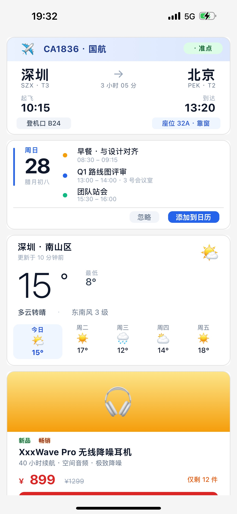
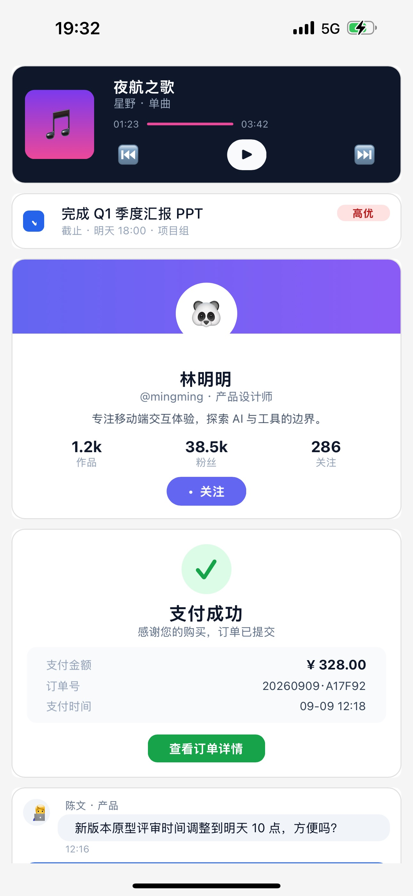
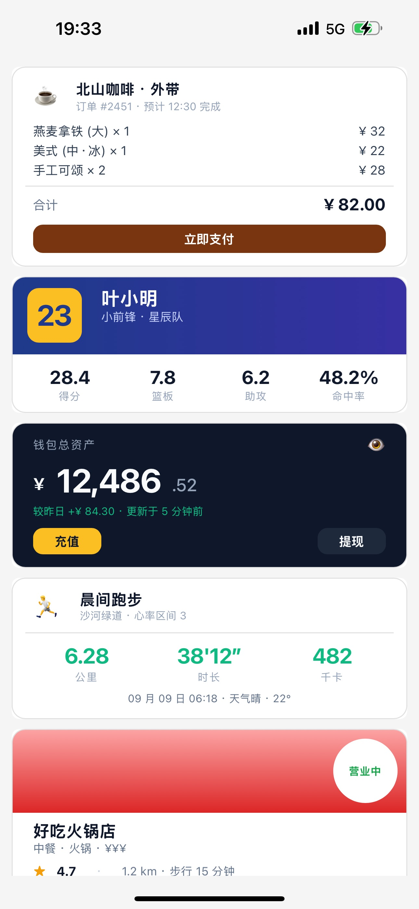
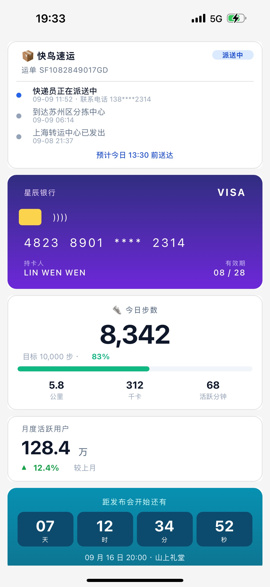

# Kuikly A2UI：让 AI 直接生成原生性能的 UI 界面

> 导语：[Kuikly](https://github.com/Tencent-TDS/KuiklyUI) 是由 PCG 端框架团队、QQ 团队、腾讯视频团队合作共建的 Kotlin Multiplatform 跨端 UI 框架，也是 [腾讯端服务联盟](https://framework.tds.qq.com/)（TDS）的重要成员。[Kuikly A2UI](https://github.com/Tencent-TDS/KuiklyUI-A2UI) 是腾讯 Kuikly 团队推出的"AI-to-UI"渲染引擎——对齐 A2UI 开源协议，让服务端大模型只需下发一段 JSON 消息流，客户端便能在 Android、iOS、HarmonyOS 上实时渲染出 100% 原生性能的 UI 界面。

---

## 简介

随着 AI 大模型的广泛使用，应用侧各种聊天对话场景里展示的内容都由大模型生成。为了将大模型生成的静态文本替换为更图形化和可交互的 UI 界面，[A2UI 协议](https://a2ui.org/) 让服务端大模型生成一段结构化 JSON，动态描述 UI 卡片，然后客户端根据 JSON 描述的 UI 树结构来渲染卡片界面。

**Kuikly A2UI 使用 Kuikly 本身优秀并经过验证的渲染能力和性能，实现了 A2UI 协议在 Android、iOS、HarmonyOS 三端的原生渲染体验，并扩展了 UI 表现效果和自定义组件等方面的能力。** 

Kuikly A2UI 支持了 A2UI 协议定义的 18 个标准组件（Text / Image / Button / Card / Column / Row / List / Tabs / Slider / CheckBox / ChoicePicker / DateTimeInput / TextField / Video / AudioPlayer / Modal / Divider / Icon），以及自定义组件，AI Agent 可灵活组合这些组件生成行程、天气、产品介绍、事项列表等各种形态的卡片。下面是 Kuikly A2UI 的一些卡片渲染效果图：

<div style="display: inline-block; text-align: center; margin-left: 20px;">
  
  
  
  
</div>

实际场景中，各类 App 有着更广泛的组件需求和显示效果，除了对标准 A2UI 协议的实现，下面能力也是 Kuikly A2UI 的支持项：

* 对表格、图表、动画等各种组件的支持
* 卡片符合 App 整体风格的主题效果支持
* 卡片内容的渐进式展示

以及在建的 Kuikly A2UI Card Studio 和 Kuikly A2UI Playground：

<div style="display: inline-block; text-align: center; margin-left: 20px;">
  
</div>

## 使用场景

Kuikly A2UI 的目标是让 AI 大模型生成交互体验更好的 UI 卡片，所以在应用聊天对话场景，或者其它 AI 大模型实时生成 UI 内容的场景，AI 大模型的回复内容里，下面情况都适合使用。

- 给出机票状态，可以生成描述机票卡片的 JSON 给客户端渲染。
- 让用户填写一个带校验的表单，可以生成描述表单卡片的 JSON 给客户端渲染，并且用户提交表单后可以产生 Action 内容回复给 AI 大模型。
- 在对话里插入一张可点击的商品卡片，可以生成描述商品信息卡片的 JSON 给客户端渲染，并且用户点击购买按钮后产生 Action，进而可以跳转商品页面进行购买，或者直接支付购买。

## 特点和优势

Kuikly A2UI 除了 A2UI 协议本身的特点，如：UI 表达丰富、支持交互、无需编译等，还有以下特点和优势：

- 性能方面：使用 Kuikly 保持了原生 UI 的性能和体验，同时内存占用小
- 表现能力：Kuikly A2UI 使用的协议基于 A2UI 协议之上做了 **UI 表现能力增强**——保持标准协议向后兼容的同时，为每个组件补充了可选的 `styles` 属性包，让服务端能更精细地定制组件的原生视觉表现（渐变、阴影、圆角、变换、文本装饰等）
- 扩展能力：Kuikly A2UI 支持扩展自定义组件、自定义函数、自定义 Icon 图片
- 接入能力：Kuikly A2UI 即支持 App 原生界面接入 AI 生成的卡片，也支持在已经是 Kuikly 页面的情况下，无缝嵌入 AI 生成的卡片

总之，使用 Kuikly A2UI 可以提高 AI 智能体和用户之间的交互体验，可以在原生页面直接集成 A2UI 卡片，也可以在已有 Kuikly 页面无缝集成 A2UI 卡片。

## 原理和架构

Kuikly A2UI 核心 SDK 提供了从 JSON 流到渲染 UI 卡片的能力，以及操作 UI 卡片产生 Action 回调给业务的能力。业务接入后可连接服务端 AI 智能体、业务客户端和 Kuikly A2UI SDK 三者。服务端 AI 智能体生成 JSON 流给到业务客户端，进而给到 Kuikly A2UI SDK 渲染 UI 卡片；用户操作 UI 卡片，产生 Action 回调给业务客户端，业务客户端根据 Action 类型，判断出本地处理 Action，还是传给服务端 AI 智能体；服务端 AI 智能体收到 Action 可以进一步生成新的 JSON 流给客户端渲染新的 UI 卡片。整个流程如下：

<div style="display: inline-block; text-align: center; margin-left: 20px;">
  
</div>

Kuikly A2UI 核心 SDK 内部直接对接 Kuikly DSL 组件树，将服务端下发的 JSON 协议转换为 Kuikly Core 管理的原生视图树，实现真正的“服务端驱动 UI”能力。内部整个流程即： 协议 → 内部消息 → DSL 操作 → 原生视图。架构图如下：

<div style="display: inline-block; text-align: center; margin-left: 20px;">
  
</div>

## 示例展示

### Demo 应用

Android / iOS / HarmonyOS 三端 Demo 已内置：

- **卡片接入示例**：加载 JSON 字符串生成 A2UI 卡片，以及通过点击添加按钮模拟卡片动态生成的过程。有机票状态卡片、日程安排卡片、天气卡片、商品卡片等。
- **组件展示**：按照 A2UI 协议定义，18 个标准组件全覆盖（Text / Image / Button / Card / Column / Row / List / Tabs / Slider / CheckBox / ChoicePicker / DateTimeInput / TextField / Video / AudioPlayer / Modal / Divider / Icon）
- **自定义组件示例**：展示了自定义 Web 组件和自定义简单 View 组件的示例。
- **自定义函数示例**：展示了 A2UI JSON 串里调用自定义函数的多个示例。
- **自定义 Icon 图片示例**：展示了 App 如果使用自定义 Icon 图片替换所有 Icon 组件默认图标的示例。

### Demo 快速体验

以 Native 页面接入 Kuikly A2UI 卡片的场景举例，Android 手机可扫码快速体验。

<div style="display: inline-block; text-align: center; margin-left: 30px;">
  
</div>

iPhone 和 HarmonyOS 手机请按如下步骤本地编译 Demo 体验。

**先决条件**：**无需**本地 clone KuiklyUI 源码。Android / iOS / HarmonyOS 三端默认都从已发布的 **Maven / CocoaPods trunk / ohpm registry** 消费 Kuikly（默认 `kuikly.version=2.30.0`）。只有和 KuiklyUI 本地源码联调时才需要开启源码模式，详见 [`SETUP-zh_CN.md`](https://github.com/Tencent-TDS/KuiklyUI-A2UI/blob/main/SETUP-zh_CN.md)。

```bash
# iOS
cd iosAppForNativePage && bash setup.sh && open A2UIDemoApp.xcworkspace

# HarmonyOS：先在【本工程根目录】执行构建脚本，产出 libshared.so 到各 ohosAppFor* 模块
./2.0_a2ui_ohos_build.sh # Debug 构建
# 然后用 DevEco Studio 打开对应目录并运行：
# ohosAppForNativePage
```

更多场景的 Demo，可按项目 [README](https://github.com/Tencent-TDS/KuiklyUI-A2UI/blob/main/README-zh_CN.md) 文档里步骤本地编译体验。

## 业界调研

业内对 Goolge A2UI 协议的实现，多维度进行一个对比如下：

| 维度 | A2UI 官方 | Flutter GenUI | Compose A2UI | AGenUI | Lynx A2UI |
|---|---|---|---|---|---|
| 协议版本 | v1.0 | genui 0.10 用 v0.9；新的 a2ui_flutter 支持 v1.0 和 v0.9 | v0.9.1（1.0.0-alpha02） | v0.9 | v0.9（正在适配 v1.0） |
| 生成 JSON 的方法 | 根据组件目录自动生成提示词；输出格式可选 JSON、Express 或 Jev 决策模型 | 提示词驱动，从模型的文本流里解析出 JSON | 只负责渲染，不负责生成 | 云端生成 Skill，分三种模式；可选让代码映射业务数据 | 用 CLI 生成提示词，模型直接输出 JSON |
| 生成精准度 | 编译时校验，错误回传模型自纠；有效率 96.1% | 靠组件 schema 加你自己的控件代码 | 先校验再渲染，出错可上报 Agent | 设计规则、白名单、校验脚本加设计 Token | 靠提示词里的硬规则，服务端校验要自建 |
| 速度与 Token | Express 约 1/3 Token，延迟最多降约 3 倍；Jev 最多快约 80 倍 | 取决于用哪个 Agent SDK | 不涉及 | UI 与数据分离、Token 主题、按差异增量修改 | 只支持完整 JSON，Token 消耗最高 |
| 内置组件 | 标准 18 个 | 18 个（Material 风格） | 18 个（Material3） | 22 个（多表格、轮播、网页、富文本）+ 45 种以上样式属性 | 22 个（含折线图、饼图、MCP App 嵌入），没有音视频 |
| 渐进显示 | 完整 JSON 可边生成边显示；Express 要等全部生成完才编译 | 每条消息到达就更新 | 子组件有加载态和动画 | 组件到达就显示，只更新变化的部分（最激进） | 每条消息有加载中、成功、失败三种状态 |
| 协议扩展 | 协议制定方：v1.0 支持混用多套组件目录、双向函数调用、扩展字段 | 自定义组件和客户端函数 | 自定义组件，接口变更保持向后兼容 | 私有样式、Token、组件覆写（表现力强，但难以移植到其他渲染器） | 远程懒加载组件、内嵌 MCP App |
| Agent SDK | Python、TypeScript、Dart | Dart（a2ui_agent）、Genkit | 无 | Skill、Studio、Go SDK | 只有提示词构建工具 |
| A2A SDK | 有（Python 版 a2ui-a2a） | 有（genui_a2a） | 无 | 只有 Go 示例 | 无 |
| 支持的端 | Web、Flutter、iOS、Android，可在 Claude/Gemini 等 AI 助手内运行 | 移动、Web、桌面 | 只有 Android | iOS、Android、鸿蒙 | iOS、Android、鸿蒙、Web |
| Playground | 在线 Playground、可视化编辑器、流式回放 | 示例 App 和组件库 App | 无 | 本地 Studio，可扫码推送到真机 | 在线 Playground，可扫码真机预览 |

### 核心差异

- **侧重点不同。​** 官方做的是协议本身加生成链路，优化 Token、速度和校验。Compose 只负责渲染。AGenUI 端云两头都做，更看重生成出来的界面好不好看、三端是否一致。Lynx 是给现有 Lynx 应用加一个渲染器，生成端很薄。
- **Token 和速度。**​ 官方的 Express 格式是目前最有效的手段，同类界面约 307 Token，完整 JSON 约 958。AGenUI 是从工程上省 Token：UI 与数据分离、主题 Token、数据交给代码填充。Lynx 只支持完整 JSON，消耗最高。
- **两个指标此消彼长。**​ Express 要等整段回复生成完才能编译，所以边生成边显示的效果反而不如完整 JSON。要两者都要，就得像官方那样先用 Jev 出界面骨架，再流式填充文字。
- **扩展与可移植性。​** AGenUI 的私有样式和组件覆写表现力最强，但同一份 JSON 拿到其他渲染器上可能会丢样式。官方 v1.0 支持混用多套组件目录，可以把这类私有组件放进单独的目录，减少移植问题。
- **生态变化。**​ 官方已把 Flutter 端拆成 a2ui_flutter、a2ui_core、a2ui_agent 三个包，用来替代 genui 包，新项目应直接用新包。Compose 还在 alpha 阶段，v1.0 支持还没到。

几点说明：上面调研于2026年11月12日前；精准度是定性判断，五家没有统一的评测；Token 数据来自 Google 官方在 gemini-3.5-flash 上的测试。

## 未来思考和支持

随着 AI 的广泛应用，对于客户端 App，从产品形态、交互体验到技术框架上都需要面向 AI 进行各种重构，Kuikly A2UI 在 Kuikly 为多端 App 开发 UI 的基础上，提供了面向用户和 AI 智能体交互的重要能力。[Kuikly A2UI](https://github.com/Tencent-TDS/KuiklyUI-A2UI) 开源，欢迎提交 Issue 和 Pull Request。

## 参考资料

- A2UI 协议官方：https://a2ui.org/
- Flutter GenUI：https://docs.flutter.dev/ai/genui
- Compose A2UI：https://developer.android.com/develop/ui/compose/agentic?hl=zh-cn
- AGenUI：https://genui.amap.com/
- Lynx A2UI：https://lynxjs.org/next/zh/blog/lynx-a2ui
